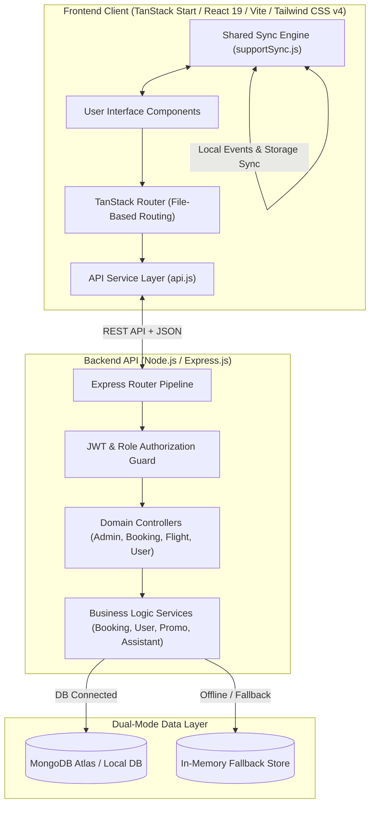

# ✈️ AirMate — Full-Stack Flight Booking & Airline Operations Platform

> **AirMate** is an enterprise-grade flight reservation, traveler self-service hub, and airline operations management system. Engineered with **React 19**, **TanStack Start (SSR & Client Hydration)**, **Tailwind CSS v4**, and an **Express.js** REST API featuring a dual-mode storage engine (MongoDB + automated in-memory fallback).

---

## 📑 Table of Contents
1. [Project Overview](#-project-overview)
2. [System Architecture](#-system-architecture)
3. [Key Highlights & Core Capabilities](#-key-highlights--core-capabilities)
4. [Detailed Module Breakdown](#-detailed-module-breakdown)
   - [Traveler Discovery & Booking Flow](#1-traveler-discovery--booking-flow)
   - [Customer & Traveler Dashboard (10 Modules)](#2-customer--traveler-dashboard)
   - [Admin Operations Command Center](#3-admin-operations-command-center)
   - [Admin-Approved Cancellation & Refund Workflow](#4-admin-approved-cancellation--refund-workflow)
   - [Real-Time Support Chat Synchronization](#5-real-time-support-chat-synchronization)
   - [Intelligent AI Travel Assistant](#6-intelligent-ai-travel-assistant)
5. [Complete REST API Reference](#-complete-rest-api-reference)
6. [Data Models & Schemas](#-data-models--schemas)
7. [Repository File Structure](#-repository-file-structure)
8. [Installation & Setup Guide](#-installation--setup-guide)
9. [Default Test Credentials](#-default-test-credentials)
10. [Production Build & Verification](#-production-build--verification)
11. [Troubleshooting & FAQ](#-troubleshooting--faq)
12. [License](#-license)

---

## 🌟 Project Overview

Modern air travel demands frictionless consumer booking experiences combined with robust, fail-safe back-office operations. **AirMate** bridges the gap between commercial airline operations and traveler convenience by delivering:

- **For Travelers**: Effortless flight discovery, interactive cabin seat selection, dynamic baggage calculation, downloadable digital boarding passes with verifiable QR codes, flight delay prediction, and an integrated real-time support desk.
- **For Airline Administrators & Operations Teams**: Real-time revenue analytics, fleet and flight inventory control, passenger manifest oversight, multi-agent support ticket queues, and a strictly controlled cancellation and refund approval workflow.
- **For Developers**: Type-safe routing via TanStack Start, unified SSR and client-side rendering, resilient storage failover (runs offline with mock storage or online with MongoDB Atlas), and an event-driven synchronization layer.

---

## 🏗️ System Architecture



### Architectural Highlights
- **Universal Rendering (SSR + Hydration)**: TanStack Start renders pages on the server for initial performance and SEO, and hydrates on the client with React 19. All browser-specific APIs (`localStorage`, `window`, `document`) are safeguarded against server-side rendering crashes.
- **Dual-Mode Persistence**: The backend connects to MongoDB when valid credentials exist; if MongoDB is unavailable or unconfigured, it automatically falls back to an in-memory data store with realistic seed data.
- **Event-Driven Cross-Tab Synchronization**: Real-time communication between the traveler desk and the admin desk operates via `StorageEvent` and in-page `CustomEvent` dispatchers, guaranteeing immediate message delivery without WebSocket setup requirements.

---

## ⚡ Key Highlights & Core Capabilities

| Capability | Description |
|---|---|
| **End-to-End Booking** | Flight search, multi-passenger selection, seat reservation, baggage add-ons, coupon discount validation, and digital pass generation. |
| **Traveler Self-Service** | 10 dedicated modules organized in an intuitive vertical sidebar layout. |
| **Admin Operations** | Centralized dashboard for managing flights, passenger manifests, audit logs, and support inquiries. |
| **Admin-Approved Refunds** | Cancellations require administrative validation before credit transactions (`REF-` IDs) are disbursed. |
| **Real-Time Live Chat** | Bi-directional, real-time message sync between customer tickets and admin operations desk without page reloads. |
| **AI Travel Assistant** | Built-in AI assistant capable of answering questions about real flights, routes, and user reservations. |
| **Delay Prediction** | Risk window scoring forecasting potential departure delays. |

---

## 🧩 Detailed Module Breakdown

### 1. Traveler Discovery & Booking Flow
1. **Search Form**: Autocomplete input for origin and destination airports with IATA codes, departure/return dates, passenger counts, and travel classes (Economy, Premium Economy, Business, First).
2. **Flight Results**: Filterable by airline, direct/connecting stops, price range, and departure times. Shows flight numbers, durations, and cabin inclusions.
3. **Passenger Info**: Collects names, emails, passport/ID details, and frequent flyer references.
4. **Interactive Seat Map**: Graphical aircraft layout depicting seat availability in real time with window/aisle indicators and premium legroom pricing.
5. **Baggage Selector**: Dynamic allowance calculations for 7kg cabin bags and 15kg/20kg/25kg check-in bags.
6. **Checkout & Promo Codes**: Instant coupon code validation against base fares with clear fare breakdowns (taxes, airport fees, discounts).
7. **Digital Boarding Pass (E-Ticket)**: Displays unique 8-character PNR, passenger manifest, seat allocations, barcode, and an SVG QR code for verification.

---

### 2. Customer & Traveler Dashboard
The customer dashboard (`/trips`) is organized into **10 dedicated modules** with an accessible left sidebar:

1. **My Trips (`tab=trips`)**:
   - Filterable tabs: *Upcoming Trips*, *Completed*, *Cancelled*, and *All Bookings*.
   - Displays PNR, flight dates, seat numbers, gate information, and status pills.
   - Live **Flight Delay Prediction** banner with risk percentage and delay windows.
   - Actions: *View E-Ticket*, *Download Pass*, *Timeline*, and *Cancel Flight*.
2. **Delay Prediction (`tab=delay-prediction`)**:
   - AI-driven delay forecasting based on weather conditions, air traffic congestion, and historical route data.
3. **Booking History (`tab=history`)**:
   - Complete historical ledger of past reservations, total fares paid, and invoice details.
4. **Saved Travellers (`tab=passengers`)**:
   - CRUD management of companion travelers, frequent flyers, date of birth, and passport details.
5. **Profile & Security (`tab=profile`)**:
   - Update full name, contact phone, home address, and change account passwords.
6. **Notifications (`tab=notifications`)**:
   - Real-time inbox for flight rescheduling alerts, gate changes, and support replies.
   - Mark as read, mark all read, and unread badge count tracking.
7. **Saved Flights & Alerts (`tab=saved-flights`)**:
   - Watchlist for favorite routes with price drop notifications and price alert toggles.
8. **Promo Codes & Deals (`tab=promos`)**:
   - Directory of active coupon codes with copy-to-clipboard functionality and percentage/fixed discount terms.
9. **Baggage Calculator (`tab=baggage`)**:
   - Interactive luggage estimator calculating baggage allowances and excess luggage pricing.
10. **Support Desk (`tab=support`)**:
    - Complete ticketing portal to submit inquiries, file refund queries, and chat live with flight operations agents.

---

### 3. Admin Operations Command Center
The admin control portal (`/admin`) provides full oversight of the airline platform:

- **Executive Overview**: High-level KPIs including Gross Revenue, Active Bookings, Total Scheduled Flights, Fleet Occupancy Rate, and monthly revenue charts.
- **Flight Management**: Schedule new flights, modify existing schedules, adjust seat pricing, reschedule departure times, or initiate flight cancellations.
- **Bookings & Manifest**: View all reservations across the platform, search by PNR or traveler name, inspect passenger details, and manually override check-in status.
- **Support Inbox**: Unified ticket queue filtered by status (*Open*, *In Progress*, *Resolved*, *Closed*), category (*Booking & Cancellation*, *Refund Query*, *Baggage*, etc.), and priority levels.
- **Audit Trails**: Detailed activity logs capturing administrative changes, timestamps, and operator IDs.

---

### 4. Admin-Approved Cancellation & Refund Workflow
To prevent unauthorized payouts and maintain audit compliance, flight cancellations follow a governed approval workflow:

```
[Traveler clicks "Cancel Flight"]
           ↓
[Cancellation submitted to backend API]
   - bookingStatus set to "cancelled"
   - refundStatus set to "pending"
   - adminApproved flag set to false
           ↓
[High-priority Support Ticket auto-created]
   - Category: "booking_cancellation"
   - Priority: "high" / "urgent"
   - PNR referenced automatically
           ↓
[Appears in Admin Support Desk with Amber Warning Box]
   - Admin inspects reason, passenger, and fare details
           ↓
[Admin clicks "Approve & Credit Refund"]
   - refundStatus updated to "processed" / "approved"
   - adminApproved set to true
   - Unique REF transaction reference generated (e.g. REF-7X8K2M)
   - Support ticket resolved
   - Confirmation email notification dispatched
           ↓
[Traveler dashboard reflects "Refund Approved & Credited"]
```

---

### 5. Real-Time Support Chat Synchronization
The customer support desk and admin support inbox communicate through the shared real-time engine [`supportSync.js`](file:///c:/Users/meruv/OneDrive/ドキュメント/Desktop/airmate-journey-maker-main/airmate-journey-maker-main/frontend/src/lib/supportSync.js):

- **Zero Hard Refreshes**: When a customer sends a reply to a ticket (e.g. `#TKT-6JKWTK`), the message is optimistically appended to local storage and an in-browser event (`airmate:support-ticket-sync`) is dispatched.
- **Cross-Tab Synchronization**: Operating multiple tabs or windows triggers native `window.addEventListener('storage')`, synchronizing traveler and admin views instantaneously.
- **Background Health Polling**: A lightweight 3-second background polling timer ensures synchronization with backend database updates.
- **Auto-Scroll Behavior**: Chat threads automatically scroll down smoothly whenever a new message is received.

---

### 6. Intelligent AI Travel Assistant
Available via `POST /api/assistant/chat`, the AirMate AI Assistant:
- Answers queries regarding available flights, airlines, routes, and layovers.
- Authenticated travelers can ask natural language questions about their own bookings:
  - *"What time does my Delhi flight take off?"*
  - *"Has my cancellation refund for PNR AM54BMZG been approved yet?"*
  - *"What are the baggage rules for my upcoming trip?"*

---

## 📡 Complete REST API Reference

### 1. Authentication Endpoints (`/api/auth`)
| Method | Endpoint | Auth | Description |
|---|---|---|---|
| `POST` | `/api/auth/register` | None | Register a new customer traveler account |
| `POST` | `/api/auth/login` | None | Customer login; returns JWT token and user profile |
| `POST` | `/api/auth/admin/login` | None | Administrator authentication |
| `GET` | `/api/auth/me` | Bearer Token | Get current authenticated user profile |
| `POST` | `/api/auth/logout` | Bearer Token | Invalidate current user session |

---

### 2. Flight Operations (`/api/flights`)
| Method | Endpoint | Auth | Description |
|---|---|---|---|
| `GET` | `/api/flights` | None | Search flights with query filters (`from`, `to`, `date`, `class`, `stops`) |
| `GET` | `/api/flights/status` | None | Retrieve flight status and live delay estimates |
| `GET` | `/api/flights/recommendations` | None | Get popular destination recommendations |
| `GET` | `/api/flights/:id` | None | Get individual flight details |
| `GET` | `/api/flights/:id/seats` | None | Get real-time seat configuration and occupied seats |
| `POST` | `/api/flights` | Admin | Create a new flight schedule |
| `PUT` | `/api/flights/:id` | Admin | Update flight route and pricing |
| `DELETE` | `/api/flights/:id` | Admin | Remove flight schedule |

---

### 3. Bookings & Reservations (`/api/bookings`)
| Method | Endpoint | Auth | Description |
|---|---|---|---|
| `POST` | `/api/bookings` | Customer | Create a new flight booking with passengers and seats |
| `GET` | `/api/bookings/my` | Customer | Fetch all personal bookings for authenticated traveler |
| `GET` | `/api/bookings/:id` | Customer/Admin | Get detailed booking receipt by PNR or ID |
| `POST` | `/api/bookings/:bookingRef/cancel` | Customer/Admin | Submit cancellation request (sets status to pending approval) |
| `GET` | `/api/bookings/:bookingRef/timeline` | Customer/Admin | Get 4-step booking and refund lifecycle timeline |
| `GET` | `/api/bookings/:bookingRef/refund-status` | Customer/Admin | Check whether refund has been approved by admin |
| `POST` | `/api/bookings/:bookingRef/payment-intent` | Customer | Create payment transaction intent |
| `POST` | `/api/bookings/:bookingRef/confirm-payment` | Customer | Confirm successful payment receipt |

---

### 4. Traveler Hub & User Settings (`/api/users`)
| Method | Endpoint | Auth | Description |
|---|---|---|---|
| `GET` | `/api/users/profile` | Customer | Get full user profile |
| `PUT` | `/api/users/profile` | Customer | Update name, phone, address, and preferences |
| `POST` | `/api/users/change-password` | Customer | Update account password |
| `GET` | `/api/users/passengers` | Customer | Get list of saved companion travelers |
| `POST` | `/api/users/passengers` | Customer | Add a new saved passenger profile |
| `DELETE` | `/api/users/passengers/:id` | Customer | Remove a saved passenger |
| `GET` | `/api/users/saved-flights` | Customer | View watchlisted flights |
| `POST` | `/api/users/saved-flights` | Customer | Bookmark a flight route |
| `PUT` | `/api/users/saved-flights/:id/alert` | Customer | Toggle price drop notification alert |
| `GET` | `/api/users/notifications` | Customer | Get user notification feed |
| `PUT` | `/api/users/notifications/:id/read` | Customer | Mark notification as read |
| `PUT` | `/api/users/notifications/read-all` | Customer | Mark all notifications as read |

---

### 5. Support Ticketing & Live Chat (`/api/users/support` & `/api/admin/support`)
| Method | Endpoint | Auth | Description |
|---|---|---|---|
| `GET` | `/api/users/support` | Customer | Fetch tickets opened by the current traveler |
| `POST` | `/api/users/support` | Customer | Open a new support ticket |
| `POST` | `/api/users/support/:ticketId/reply` | Customer | Send a message/reply in an active ticket |
| `GET` | `/api/admin/support` | Admin | Fetch all platform tickets with status/search filtering |
| `GET` | `/api/admin/support/:ticketId` | Admin | Get single ticket conversation detail |
| `POST` | `/api/admin/support/:ticketId/reply` | Admin | Send support agent reply to traveler |
| `PATCH` | `/api/admin/support/:ticketId/status` | Admin | Update status (`open`, `in_progress`, `resolved`, `closed`) |

---

### 6. Admin Management & Approvals (`/api/admin`)
| Method | Endpoint | Auth | Description |
|---|---|---|---|
| `GET` | `/api/admin/overview` | Admin | Fleet overview analytics and revenue statistics |
| `GET` | `/api/admin/flights` | Admin | Flight inventory list with search and pagination |
| `PATCH` | `/api/admin/flights/:id/reschedule` | Admin | Reschedule flight departure and arrival times |
| `PATCH` | `/api/admin/flights/:id/cancel` | Admin | Mark flight as cancelled with traveler notification |
| `GET` | `/api/admin/bookings` | Admin | All passenger bookings with filter options |
| `POST` | `/api/admin/bookings/:bookingRef/refund` | Admin | **Approve cancellation refund and disburse credit** |
| `GET` | `/api/admin/users` | Admin | Platform user directory |
| `PATCH` | `/api/admin/users/:id/role` | Admin | Promote/demote user roles |
| `GET` | `/api/admin/audit-logs` | Admin | Security audit trail logs |

---

### 7. Ancillaries, Promos & AI Assistant
| Method | Endpoint | Auth | Description |
|---|---|---|---|
| `GET` | `/api/promos` | None | List active promotional voucher codes |
| `POST` | `/api/promos/validate` | None | Validate coupon code against a base fare |
| `POST` | `/api/assistant/chat` | Optional | Query intelligent AI travel assistant |

---

## 🗄️ Data Models & Schemas

The application defines Mongoose schemas under `backend/src/models/`:

- **User (`User.js`)**: Name, email, hashed password, role (`customer`, `admin`), phone, saved passengers array, profile image.
- **Flight (`Flight.js`)**: Airline, flightNumber, from/to airports with IATA codes, departure/arrival timestamps, aircraft model, base price, seats array, status (`scheduled`, `delayed`, `departed`, `cancelled`).
- **Booking (`Booking.js`)**: Unique `bookingRef` (8-character PNR), customer ID, flight ID, passengers array, seat allocations, fare breakdown (base, taxes, baggage, promo discount, total), `bookingStatus` (`confirmed`, `cancelled`), `paymentStatus` (`paid`, `refunded`), `refundStatus` (`none`, `pending`, `processed`), `adminApproved` (boolean), refund transaction details.
- **SupportTicket (`SupportTicket.js`)**: `ticketId` (e.g. `TKT-XXXXXX`), customer ID, associated `bookingRef`, category, priority (`low`, `medium`, `high`, `urgent`), status (`open`, `in_progress`, `resolved`, `closed`), message history array (`sender`, `senderName`, `message`, `timestamp`).
- **Cancellation (`Cancellation.js`)**: `cancellationRef`, bookingRef, reason, refundAmount, status (`pending`, `approved`, `rejected`), approvedBy, refundTxId.
- **Passenger (`Passenger.js`)**: Title, firstName, lastName, age, gender, passportNumber, frequentFlyerNumber.
- **Seat (`Seat.js`)**: Seat number (e.g. `12A`), class, position (`window`, `aisle`, `middle`), extra legroom flag, price premium, occupied status.
- **PromoCode (`PromoCode.js`)**: Code, discount percentage or fixed amount, max discount, validFrom, validUntil, minBookingAmount.
- **Notification (`Notification.js`)**: User ID, title, message, type, read flag, timestamp.
- **AuditLog (`AuditLog.js`)**: Action, performedBy, targetResource, metadata, timestamp.

---

## 📂 Repository File Structure

```
airmate-journey-maker/
├── frontend/                              # Client Application (TanStack Start + React 19)
│   ├── public/                            # Static public assets, favicon
│   ├── src/
│   │   ├── components/
│   │   │   ├── admin/                     # Admin operations management tabs
│   │   │   │   ├── AdminBookingsTab.jsx   # Passenger manifest & refund actions
│   │   │   │   ├── AdminFlightsTab.jsx    # Flight scheduling & pricing
│   │   │   │   ├── AdminOverviewTab.jsx   # Analytics & KPI metrics
│   │   │   │   └── AdminSupportTab.jsx    # Real-time support chat & refund approval
│   │   │   ├── booking/                   # Booking flow components
│   │   │   │   ├── BaggageForm.jsx        # Baggage selection
│   │   │   │   ├── BookingSummary.jsx     # Fare calculations
│   │   │   │   ├── ETicket.jsx            # Boarding pass & QR code
│   │   │   │   ├── PassengerSelector.jsx  # Passenger form
│   │   │   │   └── SeatMap.jsx            # Interactive seat layout
│   │   │   ├── common/                    # Global components (Navbar, ChatBot)
│   │   │   ├── dashboard/                 # Traveler self-service tabs
│   │   │   │   ├── CustomerDashboard.jsx  # Vertical sidebar navigation layout
│   │   │   │   ├── MyTripsTab.jsx         # Bookings list & cancel modal
│   │   │   │   ├── DelayPredictionTab.jsx # Delay forecast window
│   │   │   │   ├── BookingHistoryTab.jsx  # Transaction records
│   │   │   │   ├── SavedPassengersTab.jsx # Frequent flyer profiles
│   │   │   │   ├── ProfileTab.jsx         # Profile & credentials
│   │   │   │   ├── NotificationsTab.jsx   # Notification center
│   │   │   │   ├── SavedFlightsTab.jsx    # Fare watchlists
│   │   │   │   ├── PromoCodesTab.jsx      # Coupon directory
│   │   │   │   ├── BaggageCalculatorTab.jsx # Baggage allowance estimator
│   │   │   │   └── SupportTab.jsx         # Traveler support desk & live chat
│   │   │   ├── flight/                    # Flight search cards
│   │   │   ├── search/                    # Autocomplete search bar
│   │   │   └── ui/                        # Radix UI and styled components
│   │   ├── lib/
│   │   │   ├── supportSync.js             # Shared event-driven live chat sync
│   │   │   ├── store.js                   # Client state management
│   │   │   └── utils.ts
│   │   ├── routes/                        # TanStack Start file-based routes
│   │   │   ├── __root.jsx                 # Base layout
│   │   │   ├── index.jsx                  # Landing page
│   │   │   ├── search.jsx                 # Search results page
│   │   │   ├── trips.jsx                  # Customer dashboard page
│   │   │   ├── admin.jsx                  # Admin dashboard page
│   │   │   ├── admin-login.jsx            # Admin login portal
│   │   │   ├── auth.jsx                   # Customer login/register
│   │   │   ├── checkout.jsx               # Checkout flow
│   │   │   ├── seats.jsx                  # Cabin seat map page
│   │   │   └── ticket.$bookingId.jsx      # Digital boarding pass
│   │   └── services/
│   │       └── api.js                     # Centralized API service with local sync
│   ├── package.json
│   └── vite.config.ts
│
├── backend/                               # Server Application (Node.js + Express)
│   ├── src/
│   │   ├── config/                        # Database connection config
│   │   ├── controllers/                   # HTTP request handlers
│   │   │   ├── adminController.js         # Admin endpoints & refund approval
│   │   │   ├── authController.js          # Authentication handlers
│   │   │   ├── bookingController.js       # Booking & cancellation handlers
│   │   │   ├── flightController.js        # Flight inventory handlers
│   │   │   └── userController.js          # Profile, notifications & support
│   │   ├── middleware/                    # Auth token verification, error handler
│   │   ├── models/                        # Mongoose schemas (14 domain models)
│   │   ├── routes/                        # Express API route modules
│   │   ├── services/                      # Business logic & domain services
│   │   │   ├── assistantService.js        # AI travel assistant
│   │   │   ├── bookingService.js          # Booking & refund approval logic
│   │   │   ├── promoService.js            # Promo validation
│   │   │   └── userService.js             # User & support ticket service
│   │   ├── utils/                         # Logger, formatting utilities
│   │   └── server.js                      # Application server entry
│   ├── .env.example
│   └── package.json
│
└── README.md
```

---

## 🛠️ Installation & Setup Guide

### Prerequisites
- **Node.js**: `v18.0.0` or higher
- **npm** (or **pnpm**)
- **MongoDB** *(Optional)*: If no MongoDB connection string is provided, AirMate automatically boots using its built-in in-memory fallback engine.

---

### Step 1: Clone and Install Dependencies

```sh
# Navigate to the project root directory
cd airmate-journey-maker-main

# Install backend dependencies
cd backend
npm install

# Install frontend dependencies
cd ../frontend
npm install
```

---

### Step 2: Configure Environment Variables

Create a `.env` file in the `backend/` directory:

```env
PORT=5000
NODE_ENV=development
CORS_ORIGIN=http://localhost:5173

# Database configuration (leave blank or omit to run in in-memory mode)
MONGODB_URI=mongodb+srv://<username>:<password>@cluster0.example.mongodb.net/?retryWrites=true&w=majority
MONGODB_DB_NAME=airmate

# JWT Secret & Admin Credentials
JWT_SECRET=airmate_super_secret_jwt_key_2026!
JWT_EXPIRES_IN=24h
ADMIN_EMAIL=admin@airmate.com
ADMIN_PASSWORD=Admin@AirMate2026!

# Optional: Stripe Payment Gateway
STRIPE_SECRET_KEY=
```

---

### Step 3: Run the Application

Start both servers in separate terminal windows:

#### Terminal 1: Backend Server
```sh
cd backend
npm run dev
```
*API will be listening at `http://localhost:5000`.*

#### Terminal 2: Frontend Client
```sh
cd frontend
npm run dev
```
*Application will be accessible at `http://localhost:5173`.*

---

## 🔑 Default Test Credentials

| Portal | URL Route | Email Address | Password | Permissions |
|---|---|---|---|---|
| **Admin Operations** | `/admin-login` or `/admin` | `admin@airmate.com` | `Admin@AirMate2026!` | Full administrative control, flight management, refund approval |
| **Traveler Portal** | `/auth` or `/trips` | Register any email or use demo accounts | Any password (minimum 6 chars) | Booking, cancellation, support desk, saved travelers |

---

## 🧪 Production Build & Verification

### Frontend Production Build
To verify type safety, SSR compilation, and bundle assets:

```sh
cd frontend
npm run build
```
*Runs `vite build` for both client and SSR environments. Builds must exit with code 0.*

### Backend Syntax Verification
To verify backend code syntax across all modified services and controllers:

```sh
node --check backend/src/services/bookingService.js
node --check backend/src/controllers/adminController.js
node --check backend/src/services/userService.js
```

---

## ❓ Troubleshooting & FAQ

### 1. "This page didn't load" on SSR routes
- **Cause**: Using browser-only globals (`window`, `localStorage`, `document`, `navigator`) during module initialization or SSR rendering.
- **Solution**: Always guard browser API access with `if (typeof window !== "undefined")` or inside `useEffect()` hooks.

### 2. Support chat messages not appearing across browsers
- **Cause**: Cross-browser testing uses separate browser localStorage instances.
- **Solution**: When testing traveler and admin views in different browsers, the built-in 3-second background polling timer automatically fetches updates from the backend store.

### 3. Database connection failure
- **Behavior**: AirMate detects MongoDB connection errors and automatically switches to the in-memory fallback store without crashing. All core flows (search, booking, cancellation, ticketing) remain fully testable.

---

## 📄 License

This project is licensed under the [MIT License](LICENSE).
